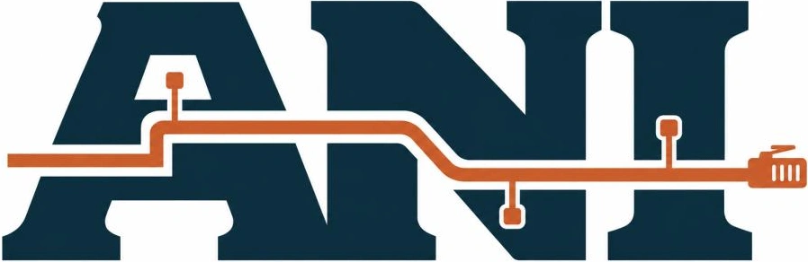
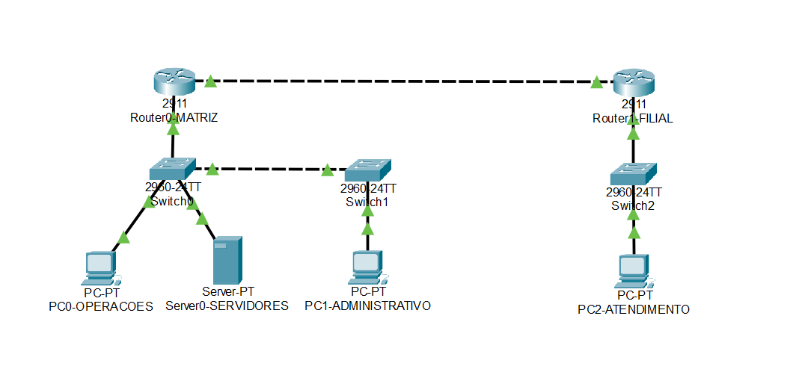

  

<h1 align="center">Advanced Network Infrastructure</h1>

<strong>Infraestrutura que conecta.</strong> 
Enterprise Connect · Redes de Computadores · Universidade Cruzeiro do Sul

  <a href="materiais/topologia.png">Ver topologia</a> ·
  <a href="materiais/Etapa2_Evidencias_Grupo6.pdf">Conferir os testes</a> ·
  <a href="materiais/Dossie_Final_Consolidado_Grupo6.pdf">Ler o dossiê</a>

## A rede da Aura Capital

Como fazer a equipe de atendimento da filial acessar uma aplicação hospedada na matriz e, ao mesmo tempo, manter o Wi-Fi de visitantes separado da rede interna? Esse foi o desafio da **Aura Capital**, a fintech do nosso estudo de caso. Criamos a ANI para assumir o papel da consultoria responsável por planejar a rede, testar a comunicação no Cisco Packet Tracer e estimar o custo de implantação.

O cabo de cobre que atravessa a nossa marca faz referência à topologia em barramento. A rede que projetamos para a Aura Capital aparece no diagrama abaixo.

| Decisão do projeto | Como ficou |
| --- | --- |
| Distribuição da equipe | 44 funcionários na matriz e 18 na filial |
| Segmentação | 9 VLANs planejadas para separar setores, servidores, Wi-Fi e gerência |
| Endereçamento IPv4 | Rede `10.6.0.0/24` dividida com VLSM. Dos 256 endereços, 220 foram destinados a blocos e 36 ficaram em reserva |
| Orçamento estimado | R$ 39.174,52 em equipamentos e materiais, mais R$ 1.900,00 por mês em links de internet |

## Do planejamento aos testes

| Etapa | O que você encontra | Material |
| --- | --- | --- |
| Planejamento | Requisitos da fintech, divisão das VLANs, sub-redes e gateways | [Plano de negócios e rede](materiais/Etapa1_PlanoDeNegocios_Grupo6.pdf) |
| Homologação | Testes de acesso ao gateway, comunicação entre VLANs e tráfego entre filial e matriz | [Evidências do laboratório](materiais/Etapa2_Evidencias_Grupo6.pdf) |
| Orçamento | Equipamentos, quantidades e separação entre investimento inicial e custo mensal | [Planilha orçamentária](materiais/Planilha_Orcamentaria_Grupo6.xlsx) |

## Abra o site

Com o repositório no computador, abra `index.html` no navegador. Em **Co-workers → Aura Capital**, você pode percorrer as três etapas, ampliar a topologia e consultar os documentos. O botão **Animações** controla a contagem dos indicadores de rede e dos valores do orçamento.

O site usa HTML, CSS e JavaScript e abre diretamente pelo arquivo.

## Quem faz a ANI

**Grupo 6** · Ciência da Computação · Campus Anália Franco

- Bianca Isabele Pereira de Melo Mariano
- Kalony da Piedade Ferreira
- Leonardo Greco dos Santos Pavanelli
- Mirella Vidal Arantes
- Rodrigo Kazuya Maeshiro
